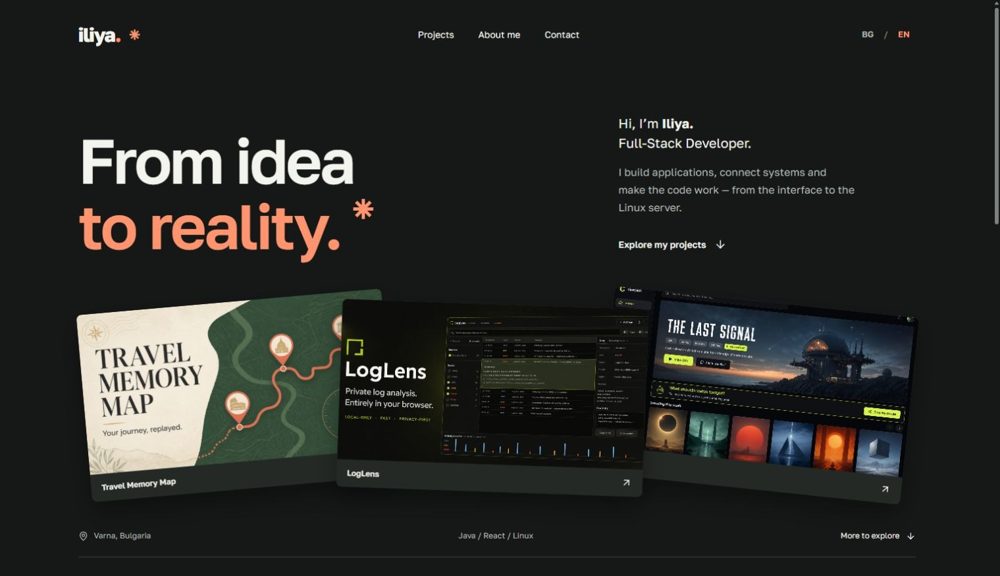
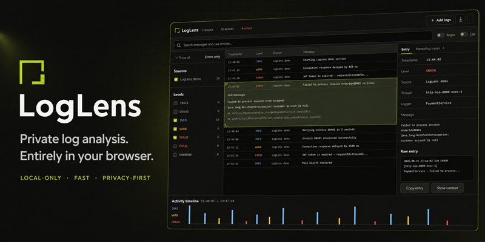
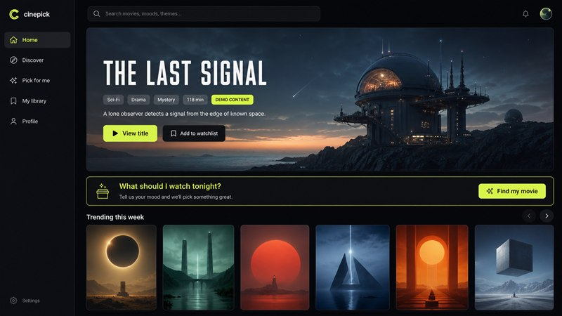
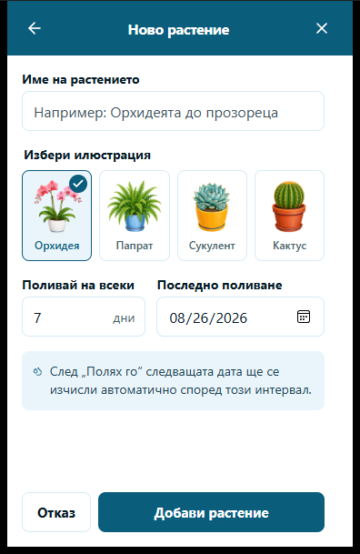

# Iliya — Personal Portfolio

My personal website: a place to explore the projects I build, get to know me as a developer, and get in touch. Available in Bulgarian and English.

## The idea

I started building small websites as a hobby. As the collection grew, I wanted a home where each project could have some context: what it does, why I built it, and how to try it.

This portfolio brings that work together with a personal introduction. It connects my interest in building useful applications with my day-to-day work across full-stack development, Linux servers and automation.

## What you'll find

- **Projects you can explore.** Visual previews, short descriptions, technology choices, and links to the applications and their source code.
- **The person behind the work.** My development interests, professional focus and the tools I work with.
- **A CV of its own.** A separate page brings together my experience, education, skills and selected projects, with a one-page PDF available in either language.
- **Two languages.** Bulgarian and English versions of the content, with a language choice that can be shared and remembered.
- **A direct way to connect.** Email, LinkedIn and GitHub links in one place.

## Selected projects

The portfolio features applications built around different everyday needs. Select a preview to explore its source code.

<table>
  <tr>
    <td align="center" width="50%">
      
      <h3><a href="https://github.com/ilynet-0302/Travel-Memory-Map">Travel Memory Map</a></h3>
      
An interactive home for travel memories, with maps, photos, trip replay and shared expenses.

    </td>
    <td align="center" width="50%">
      
      <h3><a href="https://github.com/ilynet-0302/LogLens">LogLens</a></h3>
      
Search, filter and investigate logs directly in the browser, keeping log files local.

    </td>
  </tr>
  <tr>
    <td align="center" width="50%">
      
      <h3><a href="https://github.com/ilynet-0302/Cinepick">Cinepick</a></h3>
      
Movie and TV discovery with recommendations, watchlists and collections.

    </td>
    <td align="center" width="50%">
      
      <h3><a href="https://github.com/ilynet-0302/plant-watering-widget">Water me! / Полей ме!</a></h3>
      
A Windows desktop widget for plant-watering schedules and reminders.

    </td>
  </tr>
</table>

Together, they show my interests across web applications, developer tools and desktop utilities. The site also links to smaller projects and experiments.

## Design and experience

The visual direction combines a charcoal background, warm orange accents and a lighter personal introduction. Large project previews give visitors an immediate sense of the work. Golos Text keeps the typography consistent across Latin and Cyrillic content.

The layout adapts to smaller screens, and interactions support keyboard navigation, visible focus and reduced motion. The aim is to make the projects easy to explore and the personal introduction easy to read.

## How it's built

The interface uses **React and TypeScript**, with **Vinext and Vite** generating static pages. Plain CSS handles the layout, responsive styles and animation. Fonts and preview images are served with the site.

The portfolio runs without a backend or runtime GitHub API requests. Project content and translations live together in a typed content model, making the collection straightforward to maintain as it grows. GitHub Actions handles quality checks and deployment to GitHub Pages.

## About me

I'm Iliya, a Full-Stack Developer. Alongside application development, I work with Ansible and troubleshoot the Linux servers that host our services. My personal projects give me room to explore ideas and turn practical problems into working software.

[GitHub](https://github.com/ilynet-0302) · [LinkedIn](https://www.linkedin.com/in/iliabaltadzhiev/) · [Email](mailto:iliabal0404@gmail.com)

---

Asset credits and license information are in [Third-party notices](THIRD_PARTY_NOTICES.md).
